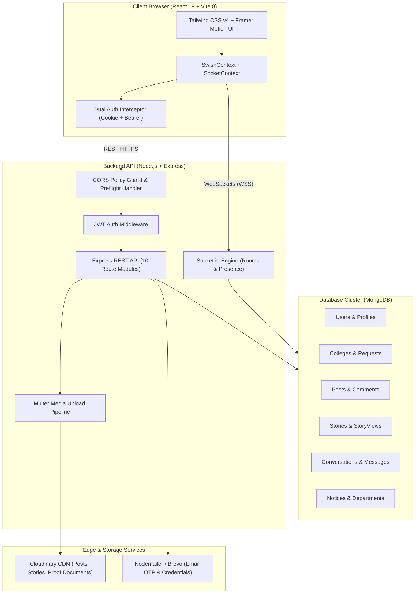
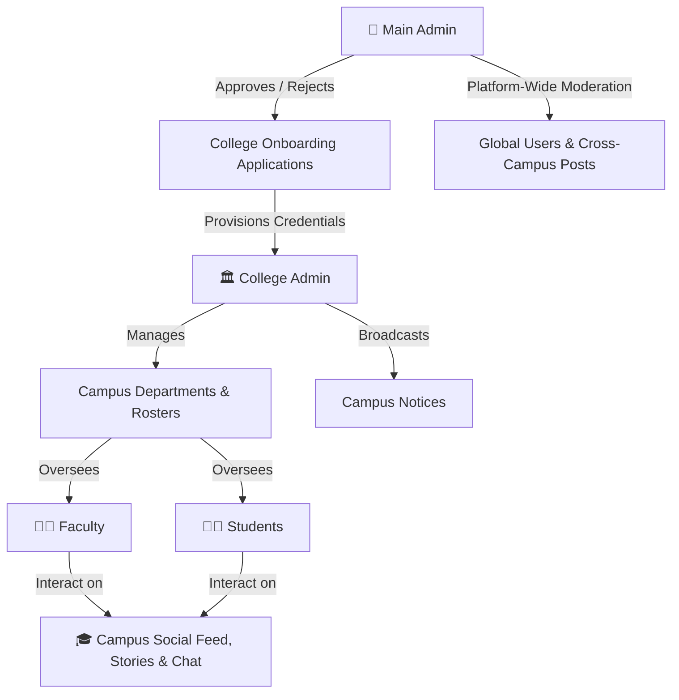
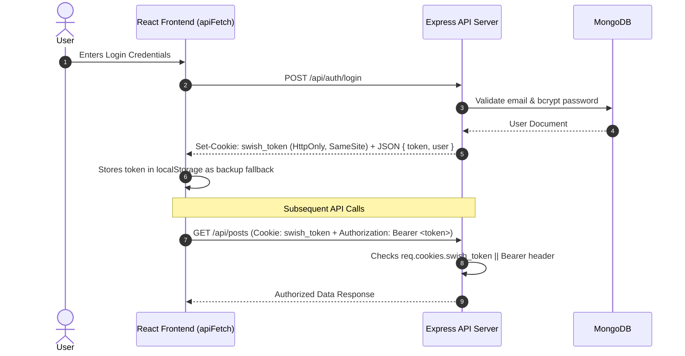
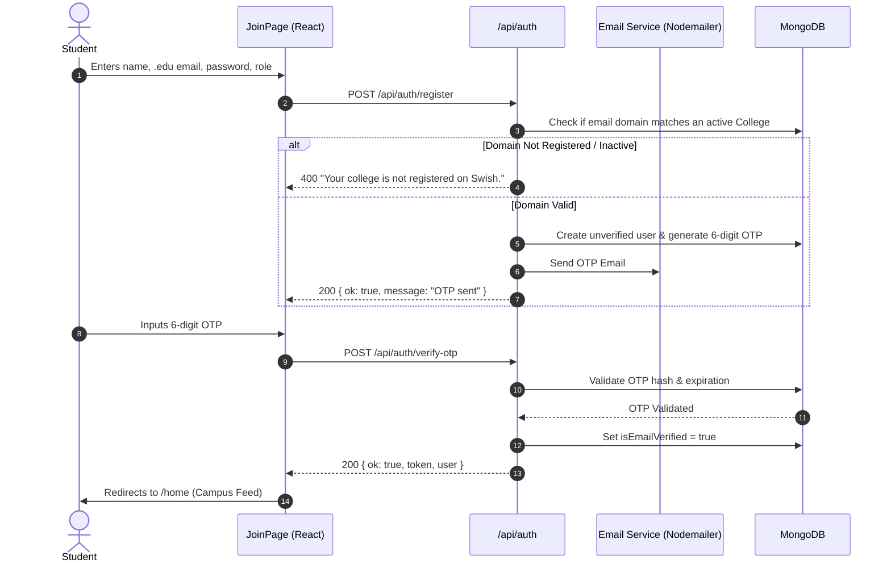
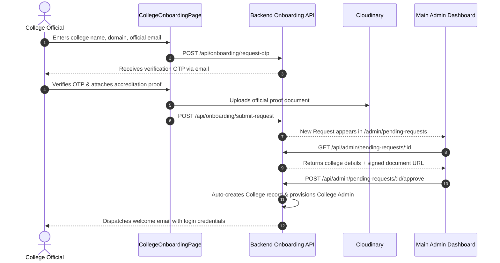
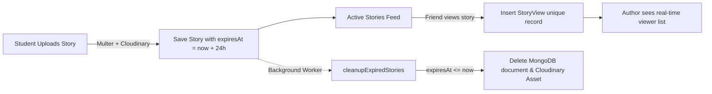
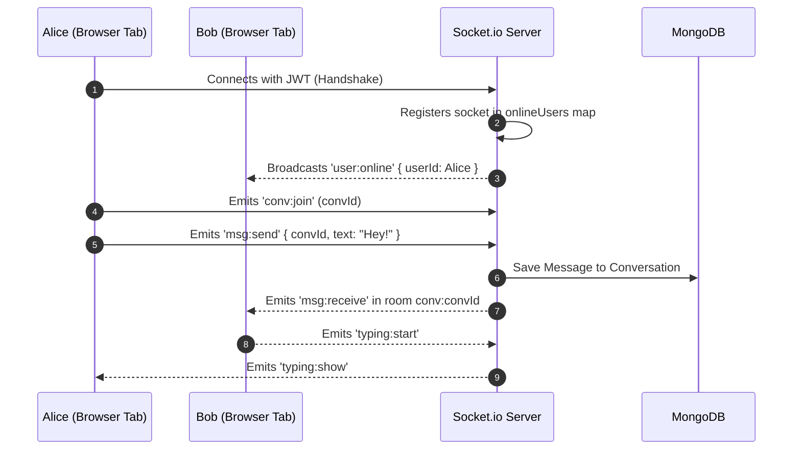

# 🎓 Swish — Campus Social Network & Community Hub

<div align="center">


**An exclusive, verified digital campus connecting students, faculty, and college administrators in one sleek, modern ecosystem.**

[](https://react.dev/)
[](https://vitejs.dev/)
[](https://tailwindcss.com/)
[](https://nodejs.org/)
[](https://www.mongodb.com/)
[](https://socket.io/)
[](https://cloudinary.com/)
[](LICENSE)

[Quickstart](#-quickstart-guide) • [Demo Credentials](#-ready-to-use-demo-accounts) • [Architecture & Workflows](#-system-architecture--core-workflows) • [Directory Contents](#-project-directory--file-guide) • [Database Models](#-database-schemas--models) • [API Reference](#-complete-api-reference) • [QA Matrix](docs/QA_TEST_CASES.md)

</div>

---

## 📖 Table of Contents

1. [Executive Summary](#-executive-summary)
2. [Key Capabilities & Feature Modules](#-key-capabilities--feature-modules)
3. [System Architecture & Core Workflows](#-system-architecture--core-workflows)
   - [3.1 High-Level Architecture](#31-high-level-architecture)
   - [3.2 Role-Based Access Control (RBAC)](#32-role-based-access-control-rbac)
   - [3.3 Dual Authentication Engine (Cookie + Bearer)](#33-dual-authentication-engine-cookie--bearer)
   - [3.4 Student/Faculty Registration & OTP Workflow](#34-studentfaculty-registration--otp-workflow)
   - [3.5 College Onboarding & Moderation Lifecycle](#35-college-onboarding--moderation-lifecycle)
   - [3.6 Ephemeral Stories System (24-Hour TTL)](#36-ephemeral-stories-system-24-hour-ttl)
   - [3.7 Real-Time Direct Messaging & Live Presence](#37-real-time-direct-messaging--live-presence)
4. [Project Directory & File Guide](#-project-directory--file-guide)
   - [4.1 Frontend Architecture (`src/`)](#41-frontend-architecture-src)
   - [4.2 Backend Architecture (`backend/src/`)](#42-backend-architecture-backendsrc)
5. [Database Schemas & Models (Mongoose)](#-database-schemas--models)
6. [Complete API Reference](#-complete-api-reference)
7. [WebSocket Event Protocol](#-websocket-event-protocol)
8. [Quickstart Guide](#-quickstart-guide)
9. [Ready-to-Use Demo Accounts](#-ready-to-use-demo-accounts)
10. [Environment Variables Reference](#-environment-variables-reference)
11. [Production Deployment & DevOps](#-production-deployment--devops)
12. [Troubleshooting & FAQs](#-troubleshooting--faqs)

---

## 🌟 Executive Summary

Public social media platforms are overwhelmed with noise, spam, and unverified actors, making it hard for universities to maintain a focused, authentic campus culture.

**Swish** solves this by establishing a **domain-gated, trusted digital campus ecosystem**:
* **Closed Campus Network**: Only users with verified institutional email domains (e.g. `@campus.edu`) can register.
* **All-in-One Experience**: Combines Instagram-style rich media feeds and stories, Slack-speed direct messaging, official college notice broadcasting, and campus administration into a single high-performance web app.
* **Institutional Governance**: A dedicated multi-tier admin hierarchy (Main Admin, College Admin, Faculty, Student) ensures campus safety, department organization, and verified credentials.

---

## ✨ Key Capabilities & Feature Modules

### 🎓 1. Domain-Gated Onboarding & Security
* **Institutional Domain Matching**: Automatically detects the user's college based on their email domain (`@domain.edu`). Registration is disallowed if the domain is not verified.
* **6-Digit Cryptographic OTP**: Employs secure email verification codes via Nodemailer/Brevo with cooldown timers and maximum attempt limits.
* **Institutional Onboarding**: Colleges apply with accreditation documents, tax IDs, and official representative contacts. Applications undergo manual Super Admin vetting before provisioning.

### 📸 2. Interactive Campus Social Feed
* **Rich Media Posts**: Upload high-resolution images powered by Multer and Cloudinary with responsive fallback gradients.
* **Atomic Likes**: Prevents race conditions using MongoDB's `$addToSet` and `$pull` operators for instant, reliable like toggling.
* **Threaded Comments**: Persistent comment counters and slide-out comment drawer with instant state synchronization.
* **User Profiles & Social Graph**: Dynamic post grids, follower/following management with atomic counts, and profile customization (bio, avatar color, graduation year, department).

### ⏳ 3. Ephemeral Campus Stories (24-Hour Expiry)
* **Stories Bar & Viewer**: Fullscreen Instagram-style story viewer with animated progress bars, pause-on-hold, and keyboard navigation.
* **View Tracking & Analytics**: Authors see real-time lists of peers who viewed their story via the `StoryView` model.
* **Automated TTL Cleanup**: Non-blocking background workers purge expired stories and their Cloudinary assets after 24 hours.

### 💬 4. Real-Time Chat & Live Presence
* **Socket.io Private Rooms**: Ultra-low-latency 1-on-1 private messaging backed by MongoDB conversation persistence.
* **Multi-Tab Presence Tracking**: Tracks active browser tabs per user ID to broadcast clean `user:online` and `user:offline` events.
* **Typing Indicators**: Real-time typing indicators with automatic idle timeouts.

### 🏛️ 5. College Administration Portal
* **Campus Metrics Dashboard**: Real-time counts of enrolled students, verified faculty, active departments, and notices.
* **Official Notice Board**: Draft, publish, and pin urgent campus announcements targeted to specific audiences (`All`, `Students`, `Faculty`).
* **Academic Roster Management**: Oversee student and faculty rosters, manage department hierarchies, and review campus engagement.

### 👑 6. Super Admin Command Center
* **Global Platform KPIs**: Real-time statistics across all enrolled colleges, registered users, and active posts.
* **Document Inspection**: Securely review uploaded college proof documents (PDFs, official letters) via signed Cloudinary URLs.
* **Automated Credential Generation**: Approving a college automatically provisions an institutional admin account with cryptographically random credentials sent directly via email.
* **Global Moderation**: Platform-wide user deactivation and post deletion capabilities.

---

## 🏗️ System Architecture & Core Workflows

### 3.1 High-Level Architecture



---

### 3.2 Role-Based Access Control (RBAC)

Swish enforces strict RBAC guards on both the frontend ([`ProtectedRoute.jsx`](src/pages/ProtectedRoute.jsx)) and backend ([`auth.middleware.js`](backend/src/middleware/auth.middleware.js)):



| Role | Scope | Accessible Routes | Protected Boundaries |
|---|---|---|---|
| **Main Admin** (`admin`) | Global platform governance | `/admin`, `/admin/pending-requests`, `/admin/pending-requests/:id` | Bypasses college isolation; cannot interact as regular student |
| **College Admin** (`college_admin`) | Single-college management | `/college-admin`, `/college-admin/*`, `/first-login`, `/change-password` | Restricted strictly to their own `collegeId` |
| **Faculty** (`faculty`) | Campus social network + academic portal | `/home`, `/explore`, `/profile/:id`, `/messages`, `/faculty/*` | Cannot access platform admin or college admin settings |
| **Student** (`student`) | Campus social network | `/home`, `/explore`, `/profile/:id`, `/messages`, `/notifications`, `/settings` | Cannot access admin dashboards or faculty tools |

---

### 3.3 Dual Authentication Engine (Cookie + Bearer)

To eliminate cross-origin authentication failures when hosting the frontend (e.g. Firebase Hosting) and backend (e.g. Render / Railway) on separate domains, Swish implements a **Dual Auth System**:



* **Why Dual Auth?** Modern browsers restrict third-party cross-site cookies by default. If the cookie is blocked in cross-domain environments, the Authorization Bearer header acts as an instant, zero-configuration failover.

---

### 3.4 Student/Faculty Registration & OTP Workflow



---

### 3.5 College Onboarding & Moderation Lifecycle



---

### 3.6 Ephemeral Stories System (24-Hour TTL)



---

### 3.7 Real-Time Direct Messaging & Live Presence



---

## 📂 Project Directory & File Guide

### 4.1 Frontend Architecture (`src/`)

```text
src/
├── components/
│   ├── app/                                 # Campus App Components
│   │   ├── AppLayout.jsx                   # Master authenticated shell with Sidebar & BottomNav
│   │   ├── BottomNav.jsx                   # Mobile-responsive bottom navigation bar
│   │   ├── CollegeNoticePanel.jsx          # Live campus bulletin board widget on Home Feed
│   │   ├── CommentDrawer.jsx               # Slide-out animated drawer for post comments
│   │   ├── CreatePostModal.jsx             # Modal with image preview, crop, tags, and caption
│   │   ├── CreateStoryModal.jsx            # 24-hr story creation with image upload
│   │   ├── DeleteConfirmModal.jsx          # Reusable safety confirmation modal
│   │   ├── EditProfileModal.jsx            # Profile update modal (bio, year, avatar colors)
│   │   ├── FollowListModal.jsx             # Modal showing list of followers / following peers
│   │   ├── MobileTopBar.jsx                # Responsive header bar for mobile views
│   │   ├── PostCard.jsx                    # Social card with media, like button, comment button
│   │   ├── PostViewerModal.jsx             # Expanded modal viewer for individual posts
│   │   ├── RightPanel.jsx                  # Right-side widget bar (notices + recommended peers)
│   │   ├── Sidebar.jsx                     # Desktop navigation sidebar with active route highlights
│   │   ├── Stories.jsx                     # Horizontal stories avatar tray
│   │   └── StoryViewer.jsx                 # Fullscreen story viewer with progress timer
│   │
│   ├── college-admin/                      # College Admin Layout & Components
│   │   └── CollegeAdminLayout.jsx          # Admin navigation shell and top bar
│   │
│   ├── Hero.jsx                            # Landing page hero section
│   ├── Navbar.jsx                          # Public top navigation with role-aware login button
│   ├── Features.jsx                        # Feature highlights grid
│   ├── ProductPreview.jsx                  # Interactive mock UI preview on landing page
│   ├── HowItWorks.jsx                      # 3-step student onboarding explainer
│   ├── SecuritySection.jsx                 # Data privacy & domain verification badges
│   ├── TrustSection.jsx                    # Verified university partnership showcase
│   ├── FinalCTA.jsx                        # Call to action footer banner
│   └── Footer.jsx                          # Public page footer
│
├── context/
│   ├── SwishContext.jsx                    # Core state store (user, posts, notices, modal states)
│   ├── SocketContext.jsx                   # Socket.io lifecycle, real-time message & presence listeners
│   └── ThemeContext.jsx                    # Dark / Light theme toggle with localStorage persistence
│
├── pages/
│   ├── app/                                # Authenticated Student & Faculty Pages
│   │   ├── HomePage.jsx                    # Main campus feed, stories bar, and notice sidebar
│   │   ├── ExplorePage.jsx                 # Search campus directory, filter by department & tags
│   │   ├── ProfilePage.jsx                 # User profile, follower counts, and personal post grid
│   │   ├── MessagesPage.jsx                # Direct messaging chat interface with typing indicators
│   │   ├── NotificationsPage.jsx           # Campus updates, likes, follows, and notice alerts
│   │   ├── SettingsPage.jsx                # User settings (password, notifications, theme)
│   │   ├── FacultyPage.jsx                 # Academic dashboard for faculty members
│   │   ├── AdminPage.jsx                   # Super Admin command center & analytics
│   │   ├── PendingRequestsPage.jsx         # Super Admin list of pending college onboarding requests
│   │   ├── PendingRequestReviewPage.jsx    # Super Admin document review & approval/rejection
│   │   └── FirstLoginPasswordPage.jsx      # Mandatory password change for new college admins
│   │
│   ├── college-admin/                      # College Admin Management Pages
│   │   ├── CollegeAdminDashboard.jsx       # Campus KPIs (students, faculty, departments, notices)
│   │   ├── StudentManagement.jsx           # Student roster search and verification status
│   │   ├── FacultyManagement.jsx           # Faculty directory and designation roster
│   │   ├── DepartmentManagement.jsx        # Department CRUD (CS, IT, Mechanical, etc.)
│   │   ├── NoticeManagement.jsx            # Official notice publishing, pinning, and deletion
│   │   ├── CollegeProfile.jsx              # Institutional details, logo, and contact info
│   │   ├── AdminProfile.jsx                # College admin personal profile settings
│   │   └── ChangePassword.jsx              # Password management
│   │
│   ├── CollegeOnboardingPage.jsx           # Public application portal for new universities
│   ├── JoinPage.jsx                        # Student / Faculty registration with email OTP
│   ├── LoginPage.jsx                       # Multi-role login page (Student, Faculty, College Admin, Super Admin)
│   ├── LandingPage.jsx                     # Marketing landing page
│   └── ProtectedRoute.jsx                  # Route guard enforcing authentication & role permissions
│
├── utils/
│   ├── auth.js                             # API client wrapper with dual auth (Bearer + Cookie)
│   └── posts.js                            # Post normalization, time formatting & image URL resolver
│
├── App.jsx                                 # Master route configuration & provider tree
├── index.css                               # Tailwind CSS v4 design tokens and glassmorphism styles
└── main.jsx                                # React application entry point
```

---

### 4.2 Backend Architecture (`backend/src/`)

```text
backend/
├── src/
│   ├── config/
│   │   ├── db.js                           # Mongoose connection with automatic retry & logging
│   │   └── cloudinary.js                   # Cloudinary SDK configuration
│   │
│   ├── middleware/
│   │   ├── auth.middleware.js              # JWT extraction (cookie/header) & role-checking guards
│   │   └── upload.middleware.js            # Multer storage configuration for posts, stories & proof docs
│   │
│   ├── models/                             # Mongoose Database Schemas
│   │   ├── User.js                         # User account, credentials, role, and profile attributes
│   │   ├── College.js                      # Registered university profile, domain, and status
│   │   ├── CollegeOnboardingRequest.js     # Pending college onboarding applications
│   │   ├── CollegeOnboardingOtp.js         # Temporary OTP cache for college onboarding
│   │   ├── Post.js                         # Campus social media posts, media, and like arrays
│   │   ├── Comment.js                      # Threaded post comments
│   │   ├── Story.js                        # 24-hr ephemeral stories with expiration index
│   │   ├── StoryView.js                    # Unique viewer tracking per story
│   │   ├── Conversation.js                 # 1-on-1 direct messaging conversation & message history
│   │   ├── Department.js                   # Academic department records per college
│   │   ├── Notice.js                       # Official college bulletin notices
│   │   └── Follow.js                       # Social graph follow/following relationships
│   │
│   ├── routes/                             # Express REST API Route Controllers
│   │   ├── admin.routes.js                 # Super Admin platform dashboard, approvals & moderation
│   │   ├── auth.routes.js                  # Authentication, login, registration, and OTP verification
│   │   ├── colleges.routes.js              # College listing, domain checks, and profile management
│   │   ├── departments.routes.js           # Department CRUD operations
│   │   ├── messages.routes.js              # Direct messaging conversations and message history
│   │   ├── notices.routes.js               # Notice board CRUD and audience targeting
│   │   ├── onboarding.routes.js            # College application submission & OTP verification
│   │   ├── posts.routes.js                 # Post creation, feeds, like toggling, and comments
│   │   ├── stories.routes.js               # Story creation, viewing tracking, and auto-cleanup
│   │   └── users.routes.js                 # User profile search, updates, and follow graphs
│   │
│   ├── services/
│   │   ├── cloudinary.service.js           # Cloudinary image upload, signed URL, and deletion helpers
│   │   ├── email.service.js                # Nodemailer and Brevo email delivery for OTPs and credentials
│   │   ├── otp.service.js                  # 6-digit OTP generation, bcrypt hashing, and validation
│   │   └── socket.service.js               # Socket.io connection engine, room routing, and presence maps
│   │
│   ├── index.js                            # Server entry point, CORS configuration, and HTTP/WS boot
│   └── seed.js                             # Database seeder populating demo accounts across all 4 roles
│
├── uploads/                                # Local filesystem media storage fallback
├── .env.example                            # Backend environment configuration template
└── package.json                            # Backend dependencies & run scripts
```

---

## 🗄️ Database Schemas & Models

| Model | Collection | Primary Attributes | Key Relationships & Indexes |
|---|---|---|---|
| **User** | `users` | `name`, `email`, `passwordHash`, `role` (`student`, `faculty`, `college_admin`, `admin`), `avatarColor`, `bio`, `dept`, `year`, `isEmailVerified`, `isActive` | References `College` and `Department`. Unique index on `email`. |
| **College** | `colleges` | `name`, `code`, `domain` (e.g. `campus.edu`), `state`, `city`, `website`, `logoUrl`, `active` | Unique indexes on `domain` and `code`. |
| **CollegeOnboardingRequest** | `collegeonboardingrequests` | `collegeName`, `domain`, `officialEmail`, `contactPerson`, `documentUrl`, `status` (`PENDING`, `APPROVED`, `REJECTED`) | Tracked by Super Admin during onboarding moderation. |
| **CollegeOnboardingOtp** | `collegeonboardingotps` | `email`, `otp` (hashed), `expiresAt`, `attempts` | TTL index on `expiresAt` for automatic expiration. |
| **Post** | `posts` | `user`, `college`, `caption`, `imageUrl`, `imagePublicId`, `tags`, `likeCount`, `commentCount`, `likes` (array of user IDs) | Indexed on `college`, `user`, and `createdAt` for feed queries. |
| **Comment** | `comments` | `post`, `user`, `content`, `createdAt` | References `Post` and `User`. Indexed on `post` and `createdAt`. |
| **Story** | `stories` | `user`, `college`, `imageUrl`, `imagePublicId`, `caption`, `expiresAt` (24h TTL) | Indexed on `user`, `expiresAt`. Auto-purged on expiration. |
| **StoryView** | `storyviews` | `story`, `viewer`, `viewedAt` | Compound unique index `{ story: 1, viewer: 1 }` prevents duplicate view counts. |
| **Follow** | `follows` | `follower`, `following`, `createdAt` | Compound unique index `{ follower: 1, following: 1 }`. Powers social graph counts. |
| **Conversation** | `conversations` | `participants` (User IDs), `messages` (embedded: `sender`, `text`, `readBy`, `createdAt`), `lastMessage`, `lastMessageAt` | Indexed on `participants` and `lastMessageAt`. |
| **Department** | `departments` | `collegeId`, `collegeName`, `name`, `code`, `headOfDepartment`, `description`, `status` | Scoped to specific `collegeId`. |
| **Notice** | `notices` | `collegeId`, `title`, `content`, `category`, `priority`, `targetAudience` (`all`, `students`, `faculty`), `isPinned`, `status` | Indexed on `collegeId`, `isPinned`, and `createdAt`. |

---

## 📡 Complete API Reference

### 🔐 1. Authentication (`/api/auth`)

| Method | Endpoint | Access | Description |
|---|---|---|---|
| `POST` | `/api/auth/register` | Public | Initiates student/faculty registration & sends email OTP |
| `POST` | `/api/auth/verify-otp` | Public | Verifies 6-digit OTP, creates verified user & issues JWT |
| `POST` | `/api/auth/resend-otp` | Public | Resends registration OTP with cooldown enforcement |
| `POST` | `/api/auth/login` | Public | Authenticates credentials, sets HttpOnly cookie & returns token |
| `GET` | `/api/auth/me` | Authenticated | Fetches current user session profile & permissions |
| `POST` | `/api/auth/logout` | Authenticated | Clears authentication cookie & terminates session |
| `POST` | `/api/auth/change-password` | Authenticated | Updates account password (used in forced first-login) |

### 👥 2. User Directory & Social Graph (`/api/users`)

| Method | Endpoint | Access | Description |
|---|---|---|---|
| `GET` | `/api/users/profile` | Authenticated | Fetches current authenticated user's full profile |
| `GET` | `/api/users/:userId` | Authenticated | Fetches public profile of a specific campus peer |
| `GET` | `/api/users/explore` | Authenticated | Searches campus peers with optional department filters |
| `PUT` | `/api/users/profile` | Authenticated | Updates name, bio, year, department, and avatar color |
| `POST` | `/api/users/:userId/follow` | Authenticated | Follows a user and atomically increments follower/following counts |
| `POST` | `/api/users/:userId/unfollow`| Authenticated | Unfollows a user and atomically decrements counts |
| `GET` | `/api/users/:userId/followers`| Authenticated| Returns list of followers for a user |
| `GET` | `/api/users/:userId/following`| Authenticated| Returns list of accounts followed by a user |

### 📸 3. Posts & Comments (`/api/posts`)

| Method | Endpoint | Access | Description |
|---|---|---|---|
| `GET` | `/api/posts` | Authenticated | Fetches recent campus posts (supports pagination) |
| `POST` | `/api/posts` | Authenticated | Creates new post with image upload (Multer `multipart/form-data`) |
| `POST` | `/api/posts/:postId/like` | Authenticated | Toggles post like status atomically using `$addToSet` / `$pull` |
| `GET` | `/api/posts/:postId/comments`| Authenticated| Fetches threaded comments for a post |
| `POST` | `/api/posts/:postId/comments`| Authenticated| Adds a comment and updates post comment counter |
| `DELETE`| `/api/posts/:postId` | Author/Admin | Deletes post and removes media asset from Cloudinary |
| `DELETE`| `/api/posts/:postId/comments/:commentId` | Author/Admin | Deletes a comment and decrements comment counter |

### ⏳ 4. Campus Stories (`/api/stories`)

| Method | Endpoint | Access | Description |
|---|---|---|---|
| `GET` | `/api/stories` | Authenticated | Returns active (unexpired) stories of user & followed peers |
| `POST` | `/api/stories` | Authenticated | Uploads story photo with caption (expires in 24 hours) |
| `POST` | `/api/stories/:storyId/view` | Authenticated | Records story view by viewer ID (unique constraint) |
| `GET` | `/api/stories/:storyId/views`| Story Author | Retrieves list of campus peers who viewed the story |
| `DELETE`| `/api/stories/:storyId` | Author/Admin | Deletes story and purges Cloudinary image asset |

### 💬 5. Direct Messaging (`/api/messages`)

| Method | Endpoint | Access | Description |
|---|---|---|---|
| `GET` | `/api/messages` | Authenticated | Lists all active 1-on-1 conversations with unread counters |
| `GET` | `/api/messages/:convId` | Authenticated | Retrieves complete message thread for a conversation |
| `POST` | `/api/messages/start/:recipientId` | Authenticated | Starts or finds an existing conversation with a user |
| `POST` | `/api/messages/:convId/send` | Authenticated | Sends a message via REST (fallback for offline sockets) |
| `POST` | `/api/messages/:convId/read` | Authenticated | Marks all messages in conversation as read |

### 🏛️ 6. Colleges & Verification (`/api/colleges`)

| Method | Endpoint | Access | Description |
|---|---|---|---|
| `GET` | `/api/colleges` | Public | Returns list of registered, active colleges |
| `GET` | `/api/colleges/check-domain` | Public | Validates if an email domain belongs to an active college |
| `GET` | `/api/colleges/my-college` | College Admin | Returns institutional profile of current college admin's campus |
| `PATCH` | `/api/colleges/:id/toggle` | Super Admin | Toggles college active status (activates/suspends campus) |

### 🏫 7. Departments (`/api/departments`)

| Method | Endpoint | Access | Description |
|---|---|---|---|
| `GET` | `/api/departments` | College Admin | Lists all departments belonging to the administrator's college |
| `POST` | `/api/departments` | College Admin | Creates a new academic department |
| `PUT` | `/api/departments/:id` | College Admin | Updates department name, code, or head of department |
| `DELETE`| `/api/departments/:id` | College Admin | Removes a department record |

### 📢 8. Campus Notices (`/api/notices`)

| Method | Endpoint | Access | Description |
|---|---|---|---|
| `GET` | `/api/notices` | College Admin | Lists all campus notices (drafts & published) |
| `GET` | `/api/notices/public/:collegeId` | Authenticated | Returns published notices visible to students/faculty |
| `POST` | `/api/notices` | College Admin | Publishes a new notice with priority and audience targeting |
| `PUT` | `/api/notices/:id` | College Admin | Modifies an existing notice |
| `DELETE`| `/api/notices/:id` | College Admin | Deletes a notice |
| `PATCH` | `/api/notices/:id/pin` | College Admin | Pins/unpins notice to the top of the campus bulletin |

### 📝 9. College Onboarding (`/api/onboarding`)

| Method | Endpoint | Access | Description |
|---|---|---|---|
| `POST` | `/api/onboarding/request-otp` | Public | Sends OTP to university official email |
| `POST` | `/api/onboarding/verify-otp` | Public | Verifies onboarding OTP before allowing document upload |
| `POST` | `/api/onboarding/submit-request` | Public | Submits institutional onboarding application with proof URL |

### 👑 10. Super Admin Command Center (`/api/admin`)

| Method | Endpoint | Access | Description |
|---|---|---|---|
| `GET` | `/api/admin/dashboard` | Super Admin | Retrieves global platform analytics & metrics |
| `GET` | `/api/admin/pending-requests` | Super Admin | Lists all pending college onboarding applications |
| `GET` | `/api/admin/pending-requests/:id` | Super Admin | Fetches single application with signed proof document URL |
| `POST` | `/api/admin/pending-requests/:id/approve` | Super Admin | Approves college, provisions admin account & sends email |
| `POST` | `/api/admin/pending-requests/:id/reject` | Super Admin | Rejects application with reason and notifies applicant |
| `GET` | `/api/admin/users` | Super Admin | Global user directory search across all campuses |
| `PATCH` | `/api/admin/users/:userId/status` | Super Admin | Deactivates or suspends a user account |
| `DELETE`| `/api/admin/posts/:postId` | Super Admin | Moderates and deletes any post across any campus |

---

## ⚡ WebSocket Event Protocol

Swish utilizes Socket.io for low-latency campus interactions. Handshake authentication occurs via JWT cookies or auth headers.

### Client-to-Server Events
| Event | Payload | Purpose |
|---|---|---|
| `conv:join` | `convId: string` | Joins a conversation room (`conv:${convId}`) |
| `conv:leave`| `convId: string` | Leaves a conversation room |
| `msg:send` | `{ convId: string, text: string }` | Sends a message; persists to DB and broadcasts to room |
| `typing:start` | `{ convId: string }` | Notifies the other participant that the user is typing |
| `typing:stop` | `{ convId: string }` | Clears typing indicator |

### Server-to-Client Events
| Event | Payload | Purpose |
|---|---|---|
| `online:list` | `userIds: string[]` | Sends list of currently online campus peers upon connection |
| `user:online` | `{ userId: string }` | Broadcasts when a peer opens their first browser tab |
| `user:offline`| `{ userId: string }` | Broadcasts when a peer closes their last active browser tab |
| `msg:receive` | `{ convId: string, message: object }` | Delivers real-time message to participants in room |
| `typing:show` | `{ convId: string, userId: string }` | Displays typing bubble in chat |
| `typing:hide` | `{ convId: string, userId: string }` | Hides typing bubble |

---

## 🚀 Quickstart Guide

Get Swish running on your local machine in under **3 minutes**:

### 1. Prerequisites
* [Node.js](https://nodejs.org/) (v18 or higher)
* [MongoDB](https://www.mongodb.com/try/download/community) running locally on `localhost:27017` (or MongoDB Atlas cluster)
* [Git](https://git-scm.com/)

---

### 2. Clone the Repository
```bash
git clone https://github.com/sarveshpatil1ui/Swish.git
cd Swish
```

---

### 3. Backend Setup

Open a terminal and set up the backend server:

```bash
# 1. Navigate to backend directory
cd backend

# 2. Install dependencies
npm install

# 3. Create your local environment file
cp .env.example .env

# 4. Seed the database with demo colleges, users, posts & follows
npm run seed

# 5. Start the backend development server
npm run dev
```

> **Backend is now live at:** `http://localhost:3001`  
> **Health Check:** `http://localhost:3001/api/health`

---

### 4. Frontend Setup

Open a **second terminal** in the project root (`Swish/`):

```bash
# 1. Install frontend dependencies
npm install

# 2. Create frontend environment file
cp .env.example .env

# 3. Start the Vite development server
npm run dev
```

> **Frontend is now live at:** `http://localhost:5173` 🎉  
> Open it in your browser and log in with any demo account!

---

## 🔑 Ready-to-Use Demo Accounts

Running `npm run seed` immediately provisions accounts across all 4 roles. **No email setup or OTP verification required for testing:**

| Role | Name | Email | Password | What to Explore |
|---|---|---|---|---|
| 👨‍🎓 **Student** | Rahul Sharma | `rahul@campus.edu` | `swish123` | Social feed, create media posts, likes, comment drawer, direct chat |
| 👩‍🎓 **Student** | Priya Desai | `priya@campus.edu` | `swish123` | Follow peers, explore feed, test real-time chat with Rahul |
| 👨‍🎓 **Student** | Arjun Mehta | `arjun@campus.edu` | `swish123` | Create stories, view campus notices, profile customization |
| 👩‍🎓 **Student** | Sneha Iyer | `sneha@campus.edu` | `swish123` | Tech posts, social interactions, profile stats |
| 👨‍🏫 **Faculty** | Demo Faculty | `faculty@campus.edu` | `faculty123` | Campus feed + Academic Faculty Portal (`/faculty`) |
| 🏛️ **College Admin** | Demo College Admin | `collegeadmin@campus.edu` | `college123` | College dashboard (`/college-admin`), campus notices, department setup |
| 👑 **Super Admin** | Platform Admin | `admin@swish.com` | `admin123` | Platform KPIs (`/admin`), college onboarding approvals, global moderation |

> 💡 **Multi-Tab Tip:** Open two different browser profiles (or an Incognito window) to test live messaging and presence between **Rahul** and **Priya**!

---

## ⚙️ Environment Variables Reference

### Backend (`backend/.env`)

| Variable | Required | Description | Example / Default |
|---|---|---|---|
| `PORT` | Optional | Express server listening port | `3001` |
| `NODE_ENV` | Optional | Environment mode | `development` |
| `CLIENT_ORIGIN` | Required | Allowed CORS origins (comma-separated for multiple) | `http://localhost:5173` |
| `MONGO_URI` | Required | MongoDB connection string (Local or Atlas) | `mongodb://127.0.0.1:27017/swish` |
| `JWT_SECRET` | Required | Cryptographically secure string (min 64 chars) | `your_super_long_random_jwt_secret` |
| `JWT_EXPIRES_IN` | Optional | Token expiration lifespan | `7d` |
| `OTP_EXPIRES_MINUTES` | Optional | Email OTP validity duration | `10` |
| `OTP_MAX_ATTEMPTS` | Optional | Maximum incorrect OTP entries before lockout | `5` |
| `CLOUDINARY_CLOUD_NAME` | Optional | Cloudinary account name for media uploads | `your_cloud_name` |
| `CLOUDINARY_API_KEY` | Optional | Cloudinary API Key | `your_api_key` |
| `CLOUDINARY_API_SECRET` | Optional | Cloudinary API Secret | `your_api_secret` |
| `SMTP_HOST` | Optional | SMTP mail server host | `smtp.gmail.com` |
| `SMTP_PORT` | Optional | SMTP mail server port | `587` |
| `SMTP_USER` | Optional | SMTP username / sender email | `your_email@gmail.com` |
| `SMTP_PASS` | Optional | Gmail App Password (16 characters) | `your_app_password` |
| `EMAIL_FROM` | Optional | Outgoing sender display header | `"Swish Campus 🎓 <noreply@swish.com>"` |

### Frontend (`.env`)

| Variable | Required | Description | Example / Default |
|---|---|---|---|
| `VITE_API_URL` | Required | URL pointing to backend API server | `http://localhost:3001` |

---

## 🌐 Production Deployment & DevOps

### 1. Frontend (Firebase Hosting or Vercel)
The frontend is built using Vite and outputs static assets to `dist/`:
```bash
npm run build
firebase deploy --only hosting
```
Configured in [`firebase.json`](firebase.json) with SPA URL rewrites:
```json
{
  "hosting": {
    "public": "dist",
    "ignore": ["firebase.json", "**/.*", "**/node_modules/**"],
    "rewrites": [{ "source": "**", "destination": "/index.html" }]
  }
}
```

### 2. Backend (Render, Railway, or VPS)
* Set `NODE_ENV=production`.
* Set `CLIENT_ORIGIN=https://swishh-5b494.web.app` (your production frontend domain).
* Start command: `npm start` (runs `node src/index.js`).
* Ensure `CLOUDINARY_*` and `SMTP_*` variables are configured in the host environment.

---

## ❓ Troubleshooting & FAQs

### 1. CORS Errors (`Blocked by CORS policy`)
* Ensure the frontend origin (`http://localhost:5173`) is listed in `backend/.env` under `CLIENT_ORIGIN`.
* The server automatically includes hardcoded origins for Firebase and localhost. Check `http://localhost:3001/api/health` to inspect active CORS origins.

### 2. Images Don't Display or Upload Fails
* If Cloudinary credentials are not set, the backend automatically falls back to local storage in `backend/uploads/`.
* The frontend's `resolveImageUrl` helper automatically prepends `http://localhost:3001` for locally served upload paths (`/uploads/...`).

### 3. Cookies Not Stored in Cross-Origin Environments
* Chrome blocks third-party cookies on non-HTTPS origins or mismatched domains.
* Swish handles this automatically via its **Dual Auth System**: the token is stored in `localStorage` and dispatched in the `Authorization: Bearer <token>` header on every request.

### 4. OTP Not Received in Development
* If SMTP credentials are not configured, OTPs are printed directly to the backend terminal console for effortless local testing.

---

## 🧪 Testing & Quality Assurance

Swish includes a complete QA specification covering all 4 user tiers, real-time sockets, and security boundaries.

👉 **View the complete test suites in [docs/QA_TEST_CASES.md](docs/QA_TEST_CASES.md)**:
* **Suite 1:** Authentication & Dual Auth Token Verification
* **Suite 2:** College Onboarding & Super Admin Document Review
* **Suite 3:** College Admin First Login & Academic Management
* **Suite 4:** Student & Faculty Registration with Domain OTP
* **Suite 5:** Posts, Multer Uploads, Likes & Threaded Comments
* **Suite 6:** Explore Search & Social Follow Graph
* **Suite 7:** Real-Time Socket Messaging & Tab Presence
* **Suite 8:** Platform Moderation & Content Removal
* **Suite 9:** Security Route Guards & XSS Prevention

---

## 👥 Contributors & Maintainers

* **Sarvesh Patil** — Project Architect & Full-Stack Lead
* **Dhruv Nayak** — Core Developer & QA Lead

Contributions and pull requests are welcome! If you encounter an issue or want to suggest a new campus feature, please open an [Issue](https://github.com/sarveshpatil1ui/Swish/issues).

---

<div align="center">
Built with ❤️ for campus communities everywhere.
</div>
